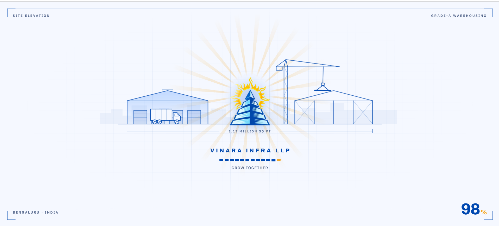
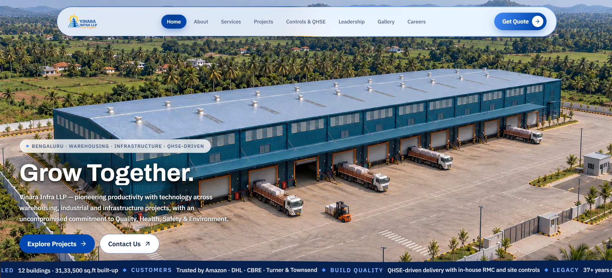
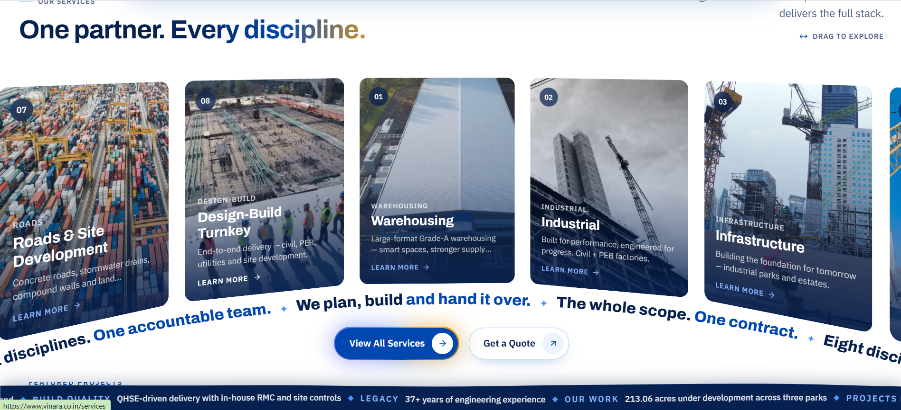
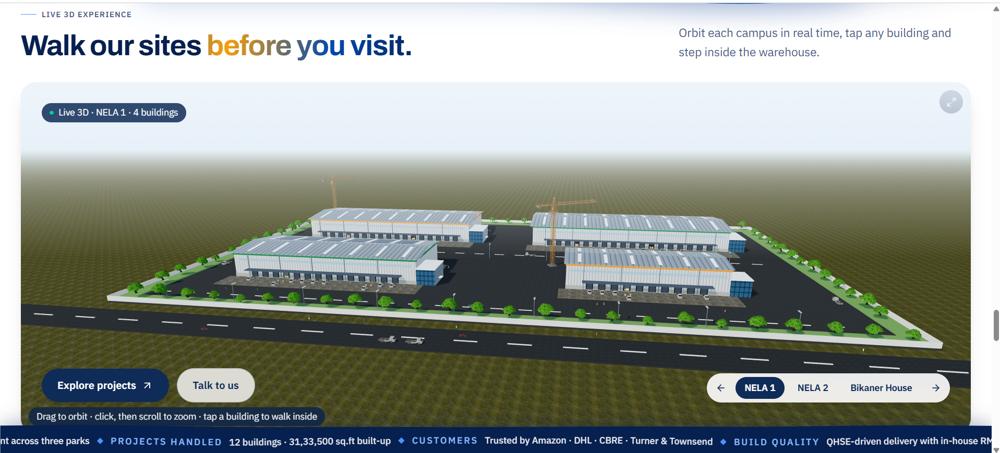
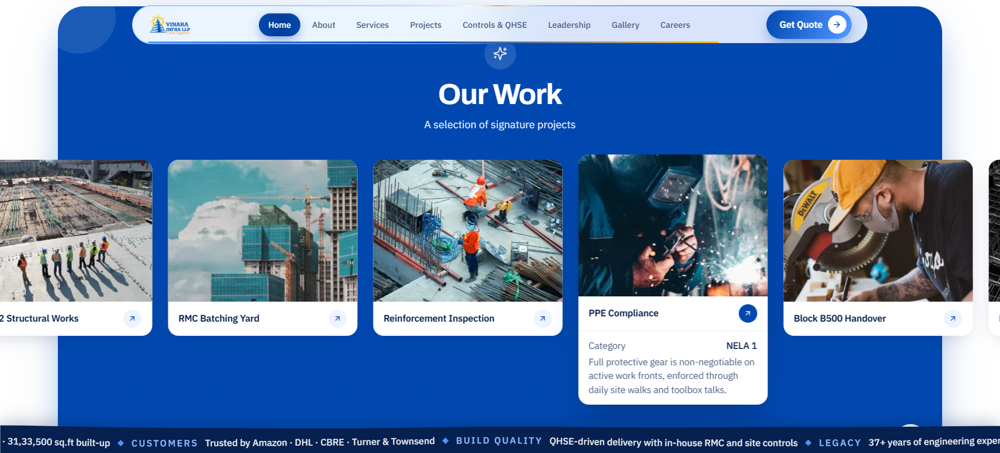
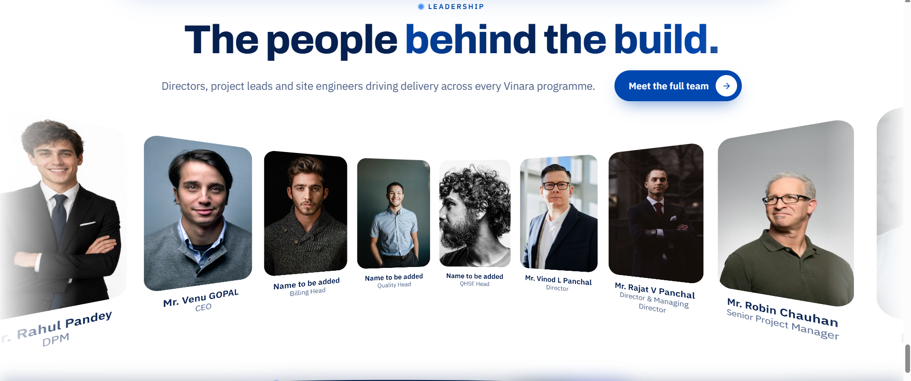
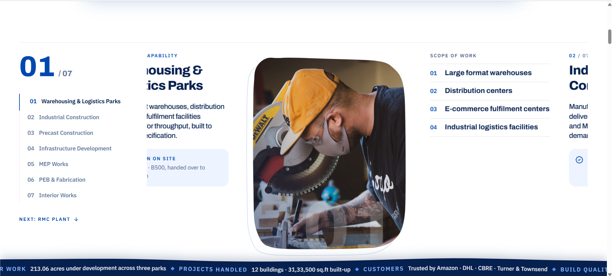
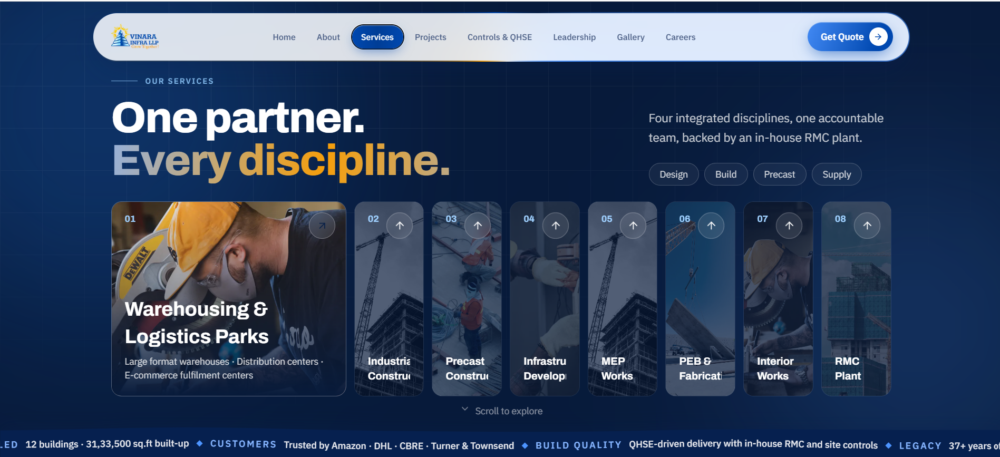
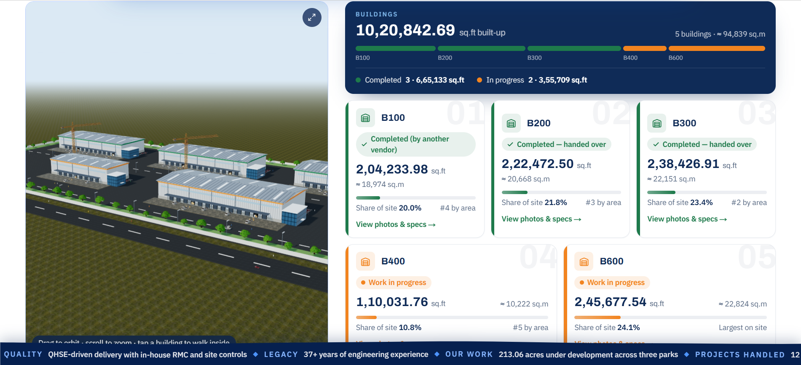

# Vinara Infra LLP — Website Showcase

Screens and the prompts used to build the official website of **Vinara Infra LLP**, a warehousing, industrial and infrastructure builder in Bengaluru, India.

> This repo is a showcase only. **It contains no source code.** The website was built with AI-assisted development (Claude Code) by giving it prompts like the ones below, one step at a time.

**Live site:** https://www.vinara.co.in

**Tech used:** Next.js 15 · React 19 · Tailwind CSS 4 · GSAP · Motion · Lenis smooth scroll · Three.js / React Three Fiber · Neon Postgres · Resend email

---

## Screens

### 1. Loading screen

> **Prompt:** "Make a loading screen that looks like a blueprint site elevation: a warehouse with a truck on the left, a crane and a steel frame on the right, and the Vinara logo glowing like a sun in the middle. Show '3.13 MILLION SQ.FT', the tagline 'GROW TOGETHER', a segmented progress bar and a big percentage counter in the corner."

### 2. Home hero

> **Prompt:** "Build a full-screen home hero with an aerial warehouse video that plays as you scroll, taken frame by frame from the 4K source. Add a floating glass navbar with a Get Quote button, the headline 'Grow Together.', two buttons (Explore Projects, Contact Us) and a scrolling ticker at the bottom with key stats: 12 buildings, 31,33,500 sq.ft, trusted by Amazon, DHL, CBRE."

### 3. Services arc

> **Prompt:** "Show the services as photo cards laid out on a curved arc that you can drag. Run a curved text marquee under the cards: 'One partner. Every discipline. We plan, build and hand it over.' It has to work on iOS Safari too."

### 4. Live 3D site experience

> **Prompt:** "Add a 'Walk our sites before you visit' section with a live 3D model of each campus (NELA 1, NELA 2, Bikaner House). Users can orbit, zoom and tap a building to walk inside. Use real 3D models with photo textures: warehouses, cranes, trees, roads and trucks."

### 5. Our Work

> **Prompt:** "Make an 'Our Work' section on a blue panel with a carousel of project cards. When you hover a card it expands to show its category and a short description. Let the admin manage the photos."

### 6. Leadership

> **Prompt:** "Make a leadership gallery with the portraits on a curved 3D strip, each with a name and role. Give every leader who doesn't have a photo yet a different stand-in portrait. Put the manpower stats at the end of the page."

### 7. Capabilities

> **Prompt:** "On the services page, make a pinned scroll section that steps through the 7 capabilities (01/07 to 07/07). Show a numbered list on the left, a description in the middle, a rounded photo and a scope-of-work list on the right, with a 'Next: RMC Plant' link."

### 8. Services page

> **Prompt:** "Give the services page a dark blue hero: 'One partner. Every discipline.' with a gold gradient, tags (Design, Build, Precast, Supply) and 8 vertical accordion cards. The active card opens wide and the others stay narrow."

### 9. Site plan and building status

> **Prompt:** "Next to the 3D site model, show a buildings dashboard: total built-up area, a progress bar split by building, and one card per building (B100 to B600) with its sq.ft and sq.m, share of the site, a Completed or Work-in-progress badge, and a 'View photos & specs' link."

---

## Other features (prompts)

- **Admin panel:** "Add an admin panel to manage gallery photos, projects, partners and leadership content without touching code."
- **Careers and quotes:** "Send job applications and quote enquiries by email with Resend to info@vinara.co.in."
- **Mobile:** "Fix the mobile menu and keep the navigation actions visible on small screens."
- **Branding:** "Replace the default favicon with the Vinara logo mark."

---

© Vinara Infra LLP. Screenshots are shared for portfolio purposes. The source code is private.
